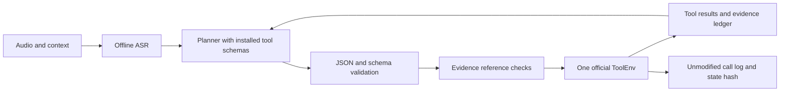

# Baseline architecture and decision

The Colab A/B workflow uses Qwen3.5-4B and PhoWhisper-medium in both arms, with the pinned Qwen3-4B-Instruct-2507 fallback. The direct arm proposes one call at a time. The compiled arm validates one full plan, resolves typed arguments from visible evidence and uses the same executor. See [the Colab guide](LIFEMATE_COLAB.md) for the run order and release gates. The earlier baseline notes below record the design before this implementation.

Decision: implement the feedback loop of candidate C, but retain all installed tools initially. Retrieval pruning is experimental until TRAIN held-out gold-tool recall demonstrates it preserves dependencies. This avoids adding a new model before a measurable planner baseline exists.

The runtime receives only permitted input fields, strips TRAIN labels, and rejects oracle transcripts on non-TRAIN splits. Historical actions provide conversational evidence but are never replayed. One environment factory invocation occurs inside each prediction. Separate offline TRAIN gold replay is a distinct process and artifact, never part of infer.

Planner emits one next action or stop. Installed tools come from context and split catalog; sys.ask_missing_info remains permitted. JSON Schema plus official validate checks structural arguments; x-one-of means at least one complete group, not exclusive choice. x-ref is evidence provenance, not a license to guess IDs. Tool outputs are untrusted data, never higher-priority instructions. Read calls affect call precision too; minimize unnecessary searches.

Preserve every attempted official call, including failures. Treat ok=true/done=false as an unsuccessful action. Bound steps and generation; reject duplicate writes, repeated identical failures, malformed JSON, unknown tools and unsupported IDs. Empty action is valid only for genuinely unsupported requests, not an accuracy claim for every query.

## Model proposal

Primary first measured candidate: **Qwen3-4B (non-thinking, greedy) + Whisper-small multilingual (Vietnamese)**. Simpler text-only loading reduces integration work. Alternative: Qwen3.5-4B once its hybrid/multimodal backend is validated. No claim of relative Vietnamese quality or latency yet.

| Artifact | Parameters from HF safetensors metadata | Revision |
|---|---:|---|
| Qwen/Qwen3-4B | 4,022,468,096 | 1cfa9a7208912126459214e8b04321603b3df60c |
| Qwen/Qwen3.5-4B (full artifact) | 4,659,865,088 | 851bf6e806efd8d0a36b00ddf55e13ccb7b8cd0a |
| openai/whisper-small | 241,734,912 | 973afd24965f72e36ca33b3055d56a652f456b4d |

Sources: [Qwen3-4B](https://huggingface.co/Qwen/Qwen3-4B), [Qwen3.5-4B](https://huggingface.co/Qwen/Qwen3.5-4B), [Whisper-small](https://huggingface.co/openai/whisper-small), metadata snapshots in docs/sources/model_metadata.json. All snapshots list Apache2.0 and last modification before cutoff. Aggregate Qwen3+Whisper=4,264,203,008; Qwen3.5+Whisper=4,901,600,000. These counts are artifact metadata, to cross-check against loaded unique tensors at release. Whisper's marketing244M differs from stored count; record exact deployed artifact.

Runtime context will be capped at16384 total, initially8192 with output budget512. Native context exceeds16K; official wording does not explicitly distinguish native from configured capacity. Eligibility remains conditional on this interpretation and deployed artifact verification. Current Transformers4.46.3 cannot be assumed compatible with Qwen3/3.5; use an isolated pinned modern stack and run loading tests before release.

Local GTX1650 4GB plus CPU-only PyTorch is sufficient for engineering checks, not evidence of 4B/ASR runtime on target. No multi-GB download/fine-tuning was started without a usable model runtime. Quantization/offload remains a development option, requiring measured latency and deterministic behavior.

## Risk register

| Risk | Current mitigation / release gate |
|---|---|
| 34 unseen PUBLIC tools | Dynamic registry; no hardcoded train-only tool list; test retrieval on held-out TRAIN. |
| IDs and result collection mapping | Source-proven evidence, reject unsupported mappings, schema-extension tests. |
| Temporal/number ambiguity | Context timezone only; explicit resolver coverage tests before replacing model values. |
| Faulty stop/retry | Done-false handling, duplicate guard, bounded feedback and clear diagnostics. |
| Timing | Soft in-process deadline is not OS preemption; enforce/tune runtime on target and record overrun as zero. |
| Scorer parity | Published local reproduction only; tokenizer conventions unverified. |
| Hardware/CUDA conflict | Record both official sources; require organizer clarification/target test. |
| No trained baseline | All ASR+LLM accuracy/runtime NOT MEASURED until weights run on paired holdout. |

## Review integration

Opus5.5 actually reviewed the supplied summary. Accepted: done=false handling, provenance, duplicate-write guard, oracle/ASR pairing, retrieval recall gate. Corrections to review: read calls definitely appear in official logs; x-match is available in the catalog; gold replay is authorized and has run successfully; hardware is now conflicting (A30 vs5090). Its proposed confidence thresholds/scores and70/15/15 split were hypotheses, not results; retain existing frozen80/20 manifest for this iteration. No prompted synthetic/test labels were generated.
